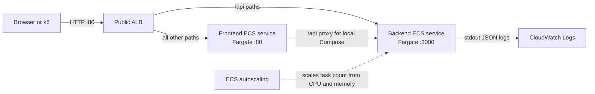

# CloudPulse ECS Load Lab

CloudPulse is a small, stateless, two-service application for demonstrating how an AWS ECS service responds to synthetic CPU load. A browser dashboard and a k6 scenario send work to a Python API; the API does deterministic CPU-intensive calculations so backend CPU utilization can drive ECS service autoscaling.

This is a demo workload, not a production application or a benchmark of real user traffic. It has no database, user accounts, or persistent application state.

## How it fits with the infrastructure

The companion [CloudPulse infrastructure repository](https://github.com/Project-Demo-for-SG/cloudpulse-ecs-infrastructure) provisions the VPC, Application Load Balancer (ALB), ECS/Fargate services, ECR repository, CloudWatch log groups, and CPU/memory target-tracking scaling policies. Deploy that infrastructure before using this repository's image-publishing workflow.



In AWS, the ALB routes `/api*` directly to the backend target group and other paths to the frontend. The frontend is static HTML served by Nginx. The API runs on FastAPI/Uvicorn and returns a hostname with its responses so requests handled by different ECS tasks can be observed. ECS tasks use private subnets without public IP addresses; the ALB is the public entry point.

## Application behavior

| Route | Purpose |
| --- | --- |
| `GET /` | API service information |
| `GET /health` and `GET /api/health` | Liveness health response; the latter is the default ECS target-group health check |
| `GET /ready` | Simple readiness response |
| `GET /api/dashboard` | Task hostname, uptime, completed work count, recent average processing time, and workload limits |
| `GET /api/work?iterations=1200000` | CPU-bound calculation and per-request timing/checksum |

`/api/work` performs a loop of square-root and sine calculations. Iterations default to 1,200,000 and are capped at 20,000,000 by the backend's `MAX_WORK_ITERATIONS` setting. Each backend task keeps its own in-memory request count and last 100 processing-time samples. These values are intentionally task-local, not shared or durable, so they reset when a task restarts and are not an application-wide total.

The API writes structured JSON request and work-completion events to standard output. In ECS, the task execution configuration sends container logs to CloudWatch Logs. The API also returns an `X-Request-ID` response header, using the incoming `x-request-id` when supplied or generating one otherwise.

## Run locally

Requirements: Docker with the Compose plugin.

From the repository root:

```bash
docker compose up --build
```

Open [http://localhost:8080](http://localhost:8080). The Compose setup exposes only the frontend; Nginx proxies `/api/` requests to the backend container. The API is also available through that proxy at `http://localhost:8080/api/health` and `http://localhost:8080/api/dashboard`.

The dashboard refreshes telemetry every three seconds. Use **Run Workload Burst** for a small functional demonstration; it sends concurrent work requests (1–20 at a time). This browser feature is not intended to generate controlled, high-volume load.

Stop the local services with:

```bash
docker compose down
```

## Run a repeatable load test

Install [k6](https://k6.io/docs/get-started/installation/), then run the included test against the local app or the deployed ALB hostname:

```bash
k6 run -e BASE_URL=http://localhost:8080 loadtest/k6.js
```

For a deployed test, use the ALB DNS name from the infrastructure Terraform output:

```bash
k6 run -e BASE_URL=http://<alb-dns-name> loadtest/k6.js
```

The scenario ramps from 0 to 5, 15, and 30 virtual users over 30, 60, and 90 seconds, then ramps down over 30 seconds. Each virtual user calls `/api/work` and sleeps briefly between requests. The default iteration count is 1,200,000; override it with `-e WORK_ITERATIONS=<count>`. The script sets example pass/fail thresholds of under 2% failed requests and a p95 response time below 5 seconds. These are test thresholds, not performance or availability guarantees.

Start with modest load and monitor AWS costs. CPU-heavy requests consume Fargate capacity; the infrastructure's default autoscaling range is 1–4 tasks per service, with target tracking on average CPU and memory. Scaling takes time and does not guarantee that every request will meet the test thresholds.

## Deploy to AWS

The infrastructure and application have separate deployment responsibilities:

1. **Provision infrastructure first.** Follow the companion infrastructure README. Its Terraform apply creates the ECR repository, ECS cluster/services, ALB, networking, and logging. Record the `alb_dns_name` and `ecr_repository_uri` outputs.
2. **Configure the app repository's GitHub Actions secrets.** Set `AWS_ROLE_ARN` to an IAM role trusted for this repository's GitHub Actions OIDC identity, and `AWS_ACCOUNT_ID` to the AWS account ID. The role needs ECR permissions to authenticate and push image layers and manifests. Use a trust policy scoped to this repository and the intended branch; do not use long-lived AWS access keys.
3. **Check the image destination.** The current workflow hardcodes `us-east-1` and `cloudpulse-app-repo`. These must match the infrastructure's AWS region and `ecr_repository_name`. The infrastructure's default tags are `frontend-latest` and `backend-latest`.
4. **Build and push the images.** A push to `main` runs the workflow unless the pushed commit's message starts with `docs:` (for example, `docs: update deployment guide`). That documentation commit is skipped so it won't rebuild or push images. Manually starting the `Deploy Application` workflow still runs it. Other pushes to `main` build the frontend and backend Docker images and push both tags to ECR. The workflow does not create infrastructure.
5. **Confirm the ECS services are healthy.** The Terraform task definitions refer to the two image tags. On the first deployment, tasks cannot start successfully until those images have been pushed; verify the services become stable and the ALB health checks pass before running k6.

### Image-push versus ECS rollout

The current app workflow only publishes images. It does **not** register a new task-definition revision or issue an ECS service deployment. Pushing new content under the same mutable `*-latest` tags does not, by itself, replace already-running tasks. For subsequent releases, explicitly update the task definition to a new image tag or force a new ECS deployment after the push, then wait for the service to become stable. Unique commit-SHA or version tags make releases easier to identify and roll back than mutable `latest` tags.

## What to observe in the demo

- **ALB:** Open the ALB DNS name to load the dashboard; the ALB listener sends `/api*` requests to the backend and other requests to the frontend.
- **ECS:** Watch backend service CPU, desired/running task counts, and service events while k6 ramps up and down. Autoscaling has cooldowns, so allow time for scale-out and scale-in.
- **CloudWatch Logs:** Inspect the frontend and backend log groups for request IDs, request timing, and `work_completed` events.
- **Dashboard:** Refresh or wait for the three-second poll. The displayed hostname helps identify which backend task answered; task-local counters and uptime differ between tasks.
- **k6:** Review request rate, errors, and latency against the scenario's thresholds. A threshold failure is useful load-test evidence, not proof of an infrastructure defect by itself.

## Design boundaries and discussion points

- The backend is deliberately CPU-bound and synchronous to produce an observable CPU signal. It is synthetic work, not a model of a specific business operation.
- State is held in each process's memory. There is no shared session state, persistence, or global aggregation across backend tasks.
- The frontend and backend are separate containers/services. Path-based routing lets the browser use one origin and avoids configuring a separate frontend API hostname.
- The infrastructure defaults to HTTP for a demo. Production use would require a custom DNS name, HTTPS/ACM, appropriately restricted ingress, and reviewed IAM/network policies.
- The private subnets do not have a NAT gateway or general outbound internet route. The infrastructure provides endpoints for the dependencies needed to pull images and deliver logs; workloads needing external APIs require an explicit egress design.
- AWS Budgets, if enabled in the infrastructure project, notify on spend but do not cap it. Load tests and autoscaling can incur charges; set a conservative test duration and clean up demo resources when finished.

## Repository map

| Path | Contents |
| --- | --- |
| `frontend/` | Static dashboard and Nginx image/configuration |
| `backend/app/main.py` | FastAPI health, telemetry, and CPU-work endpoints |
| `backend/Dockerfile` | Python API container and container health check |
| `docker-compose.yml` | Local two-container environment |
| `loadtest/k6.js` | Repeatable ramping-VU scenario |
| `.github/workflows/deploy.yml` | GitHub Actions OIDC build-and-push workflow for ECR |
